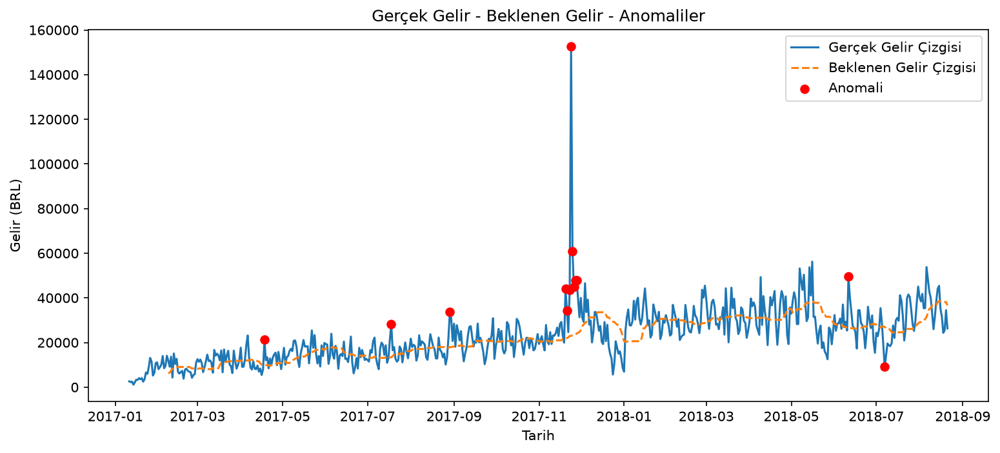

# Günlük KPI Anomali Raporu

## 1. Son Gün Özeti (2018-08-21)

| Gösterge | Değer |
| --- | --- |
| Gerçek Gelir | 26,323 BRL | 
| Beklenen Gelir | 36,646 BRL|
| Sapma |-10,323 BRL (-28.2%)|
| Durum| 🟢 Normal |
| Robust z | -1.4 (eşik ±3)

## 2. Gelir Trendi

## 3. Tespit Edilen Anomaliler (13 gün)

| Tarih      |   Gerçek Gelir (BRL) |   Beklenen Gelir (BRL) |   Sapma (BRL) | Sapma (%)   |   Robust z |
|:-----------|---------------------:|-----------------------:|--------------:|:------------|-----------:|
| 2018-07-07 |                9,077 |                 27,001 |       -17,924 | -66.4%      |       -3.1 |
| 2018-06-11 |               49,670 |                 26,418 |       +23,251 | +88.0%      |        3.4 |
| 2017-11-28 |               47,887 |                 24,007 |       +23,880 | +99.5%      |        3.9 |
| 2017-11-27 |               47,924 |                 23,519 |       +24,405 | +103.8%     |        4.3 |
| 2017-11-26 |               44,976 |                 23,214 |       +21,762 | +93.7%      |        4   |
| 2017-11-25 |               60,923 |                 23,145 |       +37,778 | +163.2%     |        7   |
| 2017-11-24 |              152,654 |                 23,017 |      +129,636 | +563.2%     |       26.1 |
| 2017-11-23 |               43,564 |                 22,896 |       +20,668 | +90.3%      |        4.9 |
| 2017-11-21 |               34,210 |                 21,952 |       +12,258 | +55.8%      |        3.4 |
| 2017-11-20 |               44,235 |                 21,952 |       +22,284 | +101.5%     |        7.1 |
| 2017-08-29 |               33,756 |                 17,963 |       +15,793 | +87.9%      |        3.1 |
| 2017-07-18 |               28,238 |                 13,326 |       +14,912 | +111.9%     |        3.2 |
| 2017-04-18 |               21,287 |                  9,859 |       +11,428 | +115.9%     |        4   |

## 4. Toplam Etki

| Yön | Gün | Toplam Sapma (BRL) |
| --- | --- | --- |
| Beklenenin üstü | 12 | +358,056 |
| Beklenenin altı | 1 | -17,924 |

## 5. Sınırlamalar

- **Isınma Dönemi:** İlk 28 gün için karşılaştırılacak geçmiş veri olmadığından değerlendirme yapılmaz.
- **Sezonsallık:** Beklenen gelir son 28 günün medyanıdır; haftanın günü etkisini bilmez.
- **Bilinen Olaylar:** Black Friday (Kasım 2017) gibi kampanya dönemleri anomali olarak işaretlenir ve tek bir olay için çok sayıda alarm üretir.
- **Neden?** Anomalinin kaynağı (kategori, bölge, ödeme tipi) bu sürümde analiz edilmez; Faz 3'te eklenecektir.
